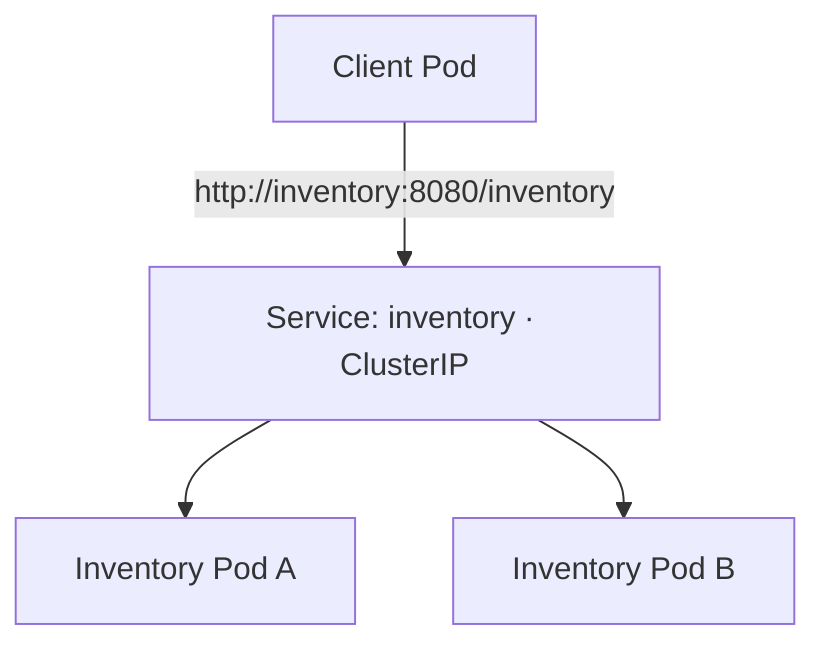

# CMPE273 Module 6: Service Discovery, Readiness & Recovery

This lab runs an Inventory application with two replicas and one client on Kubernetes. The client sends one request per second to `http://inventory:8080/inventory` using the Kubernetes Service name instead of individual Pod addresses.

## Architecture



All resources are in the `inventory-lab` namespace. The Inventory Deployment maintains two replicas through its ReplicaSet. The Service selects Pods labeled `app: inventory` and routes normal traffic to ready backends. The client has a different label, `app: inventory-client`.

## Repository contents

| File or directory | Purpose |
| --- | --- |
| `app.py` | Inventory HTTP server and readiness endpoint |
| `Dockerfile` | Builds the Inventory image using Python 3.12 |
| `.dockerignore` | Excludes unnecessary files from the Docker build context |
| `k8s/inventory.yaml` | Namespace, two-replica Deployment, readiness probe, and Service |
| `k8s/client.yaml` | One client Pod; its Python request loop is included in the YAML |
| `evidence/` | Terminal output and client logs from the recorded experiments |

There are no third-party Python dependencies to install as the application uses Python's standard library. The client reuses the image's Python runtime and overrides its startup command to run the request loop.

## Prerequisites

- Docker Desktop with its **kubeadm Kubernetes cluster** enabled and running.
- Docker CLI and `kubectl` available in the terminal.
- A copy of this repository with commands run from its root directory.

The recorded run used Docker 29.8.1 and Kubernetes/kubectl v1.36.1 on macOS. One Kubernetes node was sufficient to run both Inventory replicas and the client.

## Deploy the application

Select the local cluster and verify that its node is ready:

```bash
kubectl config use-context docker-desktop
kubectl get nodes
```

Build the local image, then deploy Inventory:

```bash
docker build -t inventory:1.0 .
kubectl apply -f k8s/inventory.yaml
kubectl rollout status deployment/inventory -n inventory-lab --timeout=120s
```

The manifest uses `imagePullPolicy: IfNotPresent`. This workflow uses the local image with Docker Desktop's kubeadm cluster as another cluster environment may require loading the image into its nodes or publishing it to a registry.

Deploy the client after Inventory is ready:

```bash
kubectl apply -f k8s/client.yaml
kubectl wait --for=condition=Ready pod/client -n inventory-lab --timeout=60s
kubectl get deployments,pods,services -n inventory-lab -o wide
```

Expected state: Deployment `inventory` shows `2/2` ready, both Inventory Pods show `1/1 Running`, the client shows `1/1 Running`, and Service `inventory` exposes port `8080/TCP`.

## 1. Service discovery and both replicas receiving requests

The `/inventory` response contains sample items and a `pod` field. Kubernetes supplies the actual Pod name through the `POD_NAME` environment variable. The client logs the target URL, response status, and serving Pod name, and opens a new connection for each request.

Let the client run for about 30 seconds, then inspect its responses:

```bash
kubectl logs client -n inventory-lab --tail=30
```

The recorded run included these successful requests:

```text
2026-10-31T21:56:00+00:00 request=68 url=http://inventory:8080/inventory status=200 pod=inventory-69dbddc45f-8b4rx
2026-10-31T21:56:01+00:00 request=69 url=http://inventory:8080/inventory status=200 pod=inventory-69dbddc45f-qtmsx
```

Both replicas received requests through the same Service name. Requests did not need to alternate evenly between replicas.

Evidence: [initial deployment](evidence/01-deployment.txt), [one client and two replicas](evidence/02-client-and-replicas.txt), and [Service traffic](evidence/02-service-traffic.txt).

## 2. Readiness failure and recovery

### How readiness works

The readiness probe sends an HTTP request to `/ready` every two seconds. The endpoint normally returns `200`. When `/tmp/inventory-not-ready` exists inside a container, it returns `503`. One failed probe marks the container unready. The Inventory process continues running, and the probe continues checking for recovery.

### Reproduce a readiness failure

Select one current Inventory Pod and create the marker file inside it:

```bash
UNREADY_POD=$(kubectl get pods -n inventory-lab -l app=inventory -o jsonpath='{.items[0].metadata.name}')
kubectl exec -n inventory-lab "$UNREADY_POD" -- touch /tmp/inventory-not-ready
kubectl wait --for=condition=Ready=false pod/"$UNREADY_POD" -n inventory-lab --timeout=30s
kubectl get pods -n inventory-lab -o wide
```

Inspect the Service backend readiness conditions:

```bash
kubectl get endpointslices -n inventory-lab \
  -l kubernetes.io/service-name=inventory \
  -o jsonpath='{range .items[*].endpoints[*]}{.targetRef.name}{" ready="}{.conditions.ready}{"\n"}{end}'
```

Allow about five seconds for routing updates. Follow fresh client responses for about 20 seconds, then press Control+C to stop following the logs as the client Pod keeps running:

```bash
kubectl logs -f client -n inventory-lab --tail=0
```

### Observed readiness failure

| Pod | READY | STATUS | RESTARTS | Endpoint ready |
| --- | --- | --- | --- | --- |
| `inventory-69dbddc45f-8b4rx` | `0/1` | Running | 0 | false |
| `inventory-69dbddc45f-qtmsx` | `1/1` | Running | 0 | true |

All 21 captured requests, numbered 632 through 652, returned `200` from `qtmsx`. For example:

```text
2026-10-31T22:05:26+00:00 request=632 url=http://inventory:8080/inventory status=200 pod=inventory-69dbddc45f-qtmsx
2026-10-31T22:05:46+00:00 request=652 url=http://inventory:8080/inventory status=200 pod=inventory-69dbddc45f-qtmsx
```

The selected Pod stayed running without restarting while the ready Pod continued serving normal Service traffic.

Evidence: [Pod status during failure](evidence/03-unready-pods.txt), [endpoint readiness](evidence/03-unready-endpoints.txt), and [traffic during failure](evidence/03-unready-traffic.txt).

### Restore readiness

In the same terminal where `UNREADY_POD` was set, remove the marker file:

```bash
kubectl exec -n inventory-lab "$UNREADY_POD" -- rm /tmp/inventory-not-ready
kubectl wait --for=condition=Ready=true pod/"$UNREADY_POD" -n inventory-lab --timeout=30s
kubectl get pods -n inventory-lab -o wide
kubectl get endpointslices -n inventory-lab \
  -l kubernetes.io/service-name=inventory \
  -o jsonpath='{range .items[*].endpoints[*]}{.targetRef.name}{" ready="}{.conditions.ready}{"\n"}{end}'
```

After routing updates, follow fresh client logs until both replica names appear:

```bash
kubectl logs -f client -n inventory-lab --tail=0
```

In the recorded run, both original Pods returned to `1/1 Running`, both endpoints showed `ready=true`, and both Pods still had zero restarts. The same previously unready Pod received requests again:

```text
2026-10-31T22:14:43+00:00 request=1186 url=http://inventory:8080/inventory status=200 pod=inventory-69dbddc45f-qtmsx
2026-10-31T22:14:44+00:00 request=1187 url=http://inventory:8080/inventory status=200 pod=inventory-69dbddc45f-8b4rx
```

Evidence: [restored Pod status](evidence/04-restored-pods.txt), [restored endpoints](evidence/04-restored-endpoints.txt), and [traffic after restoration](evidence/04-restored-traffic.txt).

## 3. Pod deletion and replacement

### Reproduce the experiment

Make sure both Inventory Pods are ready before starting. In Terminal A, record fresh traffic and leave this command running:

```bash
kubectl logs -f client -n inventory-lab --tail=0
```

In Terminal B, from the repository root, record the current resources and delete one Inventory Pod:

```bash
kubectl get deployments,pods,services -n inventory-lab -o wide
DELETE_POD=$(kubectl get pods -n inventory-lab -l app=inventory -o jsonpath='{.items[0].metadata.name}')
kubectl delete pod "$DELETE_POD" -n inventory-lab
kubectl rollout status deployment/inventory -n inventory-lab --timeout=120s
kubectl wait --for=condition=Ready pod -l app=inventory -n inventory-lab --timeout=120s
kubectl get deployments,pods,services -n inventory-lab -o wide
```

Return to Terminal A and continue observing until the surviving Pod and replacement Pod both appear in successful responses, then press Control+C.

### Observed replacement

| Resource | Before deletion | After replacement |
| --- | --- | --- |
| Selected Inventory Pod | `inventory-69dbddc45f-8b4rx`, IP `10.1.0.6` | Deleted |
| Replacement Inventory Pod | Not present | `inventory-69dbddc45f-bd6rk`, IP `10.1.0.9`, `1/1 Running` |
| Surviving Inventory Pod | `inventory-69dbddc45f-qtmsx` | Same Pod, `1/1 Running` |
| Inventory Deployment | `2/2` ready | `2/2` ready |
| Service | `inventory`, ClusterIP `10.110.37.78` | Same name and ClusterIP |
| Client | `client`, IP `10.1.0.8`, zero restarts | Same name and IP, zero restarts |

The deletion command confirmed that `inventory-69dbddc45f-8b4rx` was deleted. Kubernetes created `inventory-69dbddc45f-bd6rk` without a manual Pod-creation command or another deployment apply.

The client capture contains 228 consecutive requests, numbered 1498 through 1725. All returned status `200` with no logged errors. It includes responses from the old Pod, surviving Pod, and replacement Pod:

```text
2026-10-31T22:20:48+00:00 request=1549 url=http://inventory:8080/inventory status=200 pod=inventory-69dbddc45f-8b4rx
2026-10-31T22:20:53+00:00 request=1554 url=http://inventory:8080/inventory status=200 pod=inventory-69dbddc45f-qtmsx
2026-10-31T22:20:54+00:00 request=1555 url=http://inventory:8080/inventory status=200 pod=inventory-69dbddc45f-bd6rk
2026-10-31T22:20:55+00:00 request=1556 url=http://inventory:8080/inventory status=200 pod=inventory-69dbddc45f-qtmsx
```

The client kept using `http://inventory:8080/inventory` throughout the recorded experiment. These results describe this observation window. A stable Service name does not guarantee that every in-flight request will succeed during every possible failure.

Evidence: [before deletion](evidence/05-before-deletion.txt), [deletion confirmation](evidence/05-deletion.txt), [after replacement](evidence/05-after-replacement.txt), and [client traffic across replacement](evidence/05-replacement-traffic.txt).

The results below are from my lab run. Pod names and IP addresses may be different when you run it again.

## Cleanup

After finishing the experiments, remove the lab resources with:

```bash
kubectl delete namespace inventory-lab
```

This removes this lab's client, Inventory Deployment and Pods, and Service. The local image and repository evidence files remain available.

## Reflection

A stable Service name gives the client one address to use even when individual Pods fail or are replaced. Kubernetes updates the Service's available backends so the client does not need to track Pod names or IP addresses. Readiness probes help keep normal traffic away from Pods that are running but temporarily unable to serve requests. In this lab, the client kept using `http://inventory:8080/inventory` while we changed readiness and deleted an Inventory Pod.